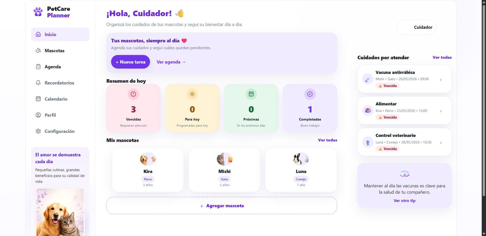
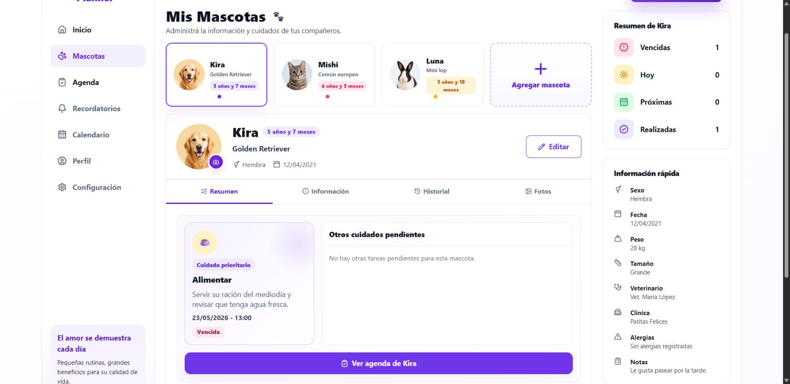
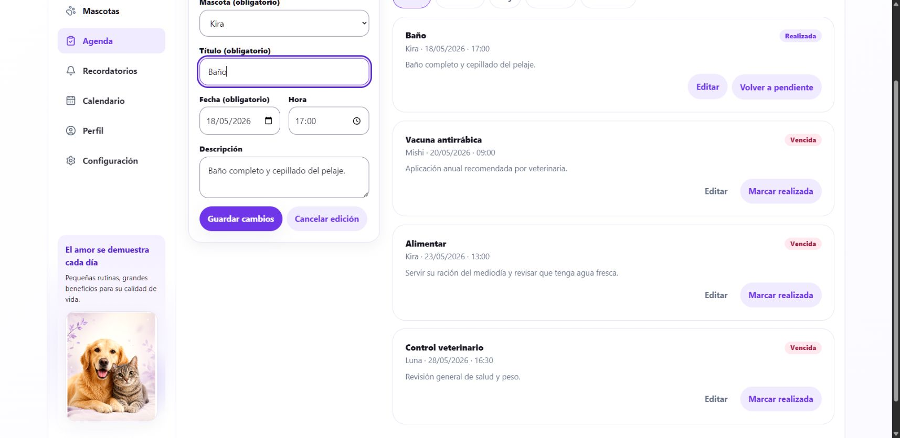

# PetCare Planner

Aplicación web para registrar mascotas y gestionar sus cuidados. Desde cada ficha se puede consultar el historial y abrir una agenda filtrada por mascota. Proyecto grupal de IntegrarTEC, Equipo 11.

[Abrir demo pública](https://petcare-planner-grupo11.vercel.app/) · [Probar en local](#9-demo-local) · [Ver mi aporte](#mi-aporte) · [Repositorio original](https://github.com/slaguirre1809-hash/petcare-planner-grupo11)

---

## Tabla de contenidos

- [1. Descripción](#1-descripción)
- [2. Objetivo del proyecto](#2-objetivo-del-proyecto)
- [3. Integrantes](#3-integrantes)
- [4. Tecnologías utilizadas](#4-tecnologías-utilizadas)
- [5. Funcionalidades principales](#5-funcionalidades-principales)
- [6. Estructura del proyecto](#6-estructura-del-proyecto)
- [7. Arquitectura y organización del código](#7-arquitectura-y-organización-del-código)
- [8. Cómo probar la Agenda](#8-cómo-probar-la-agenda)
- [9. Demo local](#9-demo-local)
- [10. Demo publicada y capturas](#10-demo-publicada-y-capturas)
- [11. Persistencia de datos](#11-persistencia-de-datos)
- [12. Estado del proyecto / alcance MVP](#12-estado-del-proyecto--alcance-mvp)
- [13. Uso de IA](#13-uso-de-ia)
- [14. Enlaces](#14-enlaces)
- [15. Posibles mejoras futuras](#15-posibles-mejoras-futuras)
- [16. Licencia](#16-licencia)

---

## 1. Descripción

**PetCare Planner** es una aplicación web pensada para organizar los cuidados diarios de nuestras mascotas.  
Permite llevar un registro claro de necesidades importantes como:

- aplicación de vacunas,
- visitas al veterinario,
- paseos,
- baños,
- administración de medicamentos.

La app funciona como una herramienta de organización personal enfocada en el bienestar animal, para que no se pase por alto ninguna fecha importante.

---

## 2. Objetivo del proyecto

Construir un **MVP funcional, simple y claro** (HTML + CSS + JavaScript vanilla) que permita:

- registrar mascotas,
- planificar tareas de cuidado,
- hacer seguimiento de estados (pendiente, vencida, realizada),
- visualizar información de manera rápida y amigable.

---

## 3. Integrantes

- **Magalí Aldana Suárez** — Mascotas, alta de perfiles y presentación de sus datos.
- **Santiago** — Agenda, fechas, filtros por estado y actualización de tareas.
- **Luca Almiron** — Inicio, estadísticas y listado de cuidados.

### Mi aporte

Me encargué de la sección **Mascotas**. También trabajé en la navegación compartida, el pie de página responsive y la integración de la entrega grupal.

- [Vista previa de la foto en Mascotas](https://github.com/Nat-magui/petcare-planner-grupo11/commit/96a4bf44a4)
- [Navegación compartida de escritorio](https://github.com/Nat-magui/petcare-planner-grupo11/commit/3d4770d149)
- [Ajustes del pie de página](https://github.com/Nat-magui/petcare-planner-grupo11/commit/bbfd4de79c)
- [Integración de la entrega grupal](https://github.com/Nat-magui/petcare-planner-grupo11/commit/2a5d875ac8)

En este fork unifiqué el cálculo de estados y la navegación, mejoré el guardado de mascotas y la accesibilidad de los formularios, e incorporé el historial y la agenda por mascota. También agregué la edición y reapertura de cuidados.

- [Historial y agenda por mascota](https://github.com/Nat-magui/petcare-planner-grupo11/pull/14)
- [Edición y reapertura de cuidados](https://github.com/Nat-magui/petcare-planner-grupo11/pull/15)

---

## 4. Tecnologías utilizadas

- **HTML5**
- **CSS3**
- **JavaScript (Vanilla)**
- **LocalStorage** (persistencia en navegador)

---

## 5. Funcionalidades principales

### 5.1 Gestión de mascotas
- Registro de una o varias mascotas.
- Perfil por mascota con datos básicos y de salud.
- Edición de información de mascota.
- Historial de cuidados con enlaces a sus tarjetas en Agenda.

### 5.2 Agenda centralizada
- Alta de tareas de cuidado con fecha obligatoria y hora opcional.
- Asociación de cada tarea a una mascota.
- Agenda filtrada desde la ficha, con la mascota preseleccionada en el formulario.

### 5.3 Seguimiento de tareas
- Edición de los datos de un cuidado con su estado actual.
- Marcado como realizada y opción de volver a pendiente.

### 5.4 Filtros por estado
- Agenda incluye los filtros **Todas**, **Vencidas**, **Hoy**, **Próximas** y **Realizadas**.
- Las tareas activas se clasifican por fecha local. La hora orienta el cuidado dentro del día.

### 5.5 UI por tarjetas
- Lectura rápida con estilos diferenciados:
  - **Vencida**
  - **Hoy**
  - **Próxima**
  - **Realizada**

---

## 6. Estructura del proyecto

```txt
petcare-planner-grupo11/
├─ index.html
├─ pages/
│  ├─ mascotas.html
│  └─ agenda.html
├─ assets/
│  ├─ css/
│  │  ├─ base.css
│  │  ├─ components.css
│  │  ├─ index.css
│  │  ├─ mascotas.css
│  │  └─ agenda.css
│  ├─ js/
│  │  ├─ data.js
│  │  ├─ utils.js
│  │  ├─ storage.js
│  │  ├─ index.js
│  │  ├─ mascotas.js
│  │  ├─ agenda.js
│  │  └─ layout.js
│  └─ img/
│     └─ ...
└─ README.md
```

---

## 7. Arquitectura y organización del código

### JavaScript
- `data.js`: datos iniciales.
- `utils.js`: helpers puros reutilizables.
- `storage.js`: lectura/escritura y operaciones de datos en LocalStorage.
- `index.js`, `mascotas.js`, `agenda.js`: lógica de cada página.
- `layout.js`: render compartido de navegación/footer.

### CSS
- `base.css`: reset, variables, estilos globales.
- `components.css`: componentes reutilizables (botones, cards, nav, etc).
- `index.css`, `mascotas.css`, `agenda.css`: estilos específicos por página.

---

## 8. Cómo probar la Agenda

1. En **Mascotas**, agregá una mascota llamada **Bruma**.
2. Desde su ficha, elegí **Ver agenda de Bruma**. La agenda muestra sus cuidados y preselecciona a Bruma en el formulario.
3. Creá **Control veterinario** con la fecha de hoy. Elegí **Editar**, cambiá el título a **Control anual** y guardá. Después de recargar, debe seguir habiendo una sola tarea con el título actualizado.
4. Elegí **Marcar realizada**, abrí el filtro **Realizadas** y verificá que la tarea aparezca allí.
5. Elegí **Volver a pendiente**. Recargá y comprobá que la tarea aparezca en **Hoy** y que el contador de Inicio refleje el cambio.
6. Volvé a **Mascotas → Bruma → Historial**. Confirmá que aparece el cuidado y que **Ver en Agenda** abre su tarjeta.

## 9. Demo local

Cloná el fork y serví la carpeta con Node.js:

```bash
git clone https://github.com/Nat-magui/petcare-planner-grupo11.git
cd petcare-planner-grupo11
npx serve .
```

Abrí la URL que muestra el comando. También podés abrir `index.html` con **Live Server** desde VS Code. Usá la misma URL durante todo el recorrido para conservar el almacenamiento de la prueba.

---

## 10. Demo publicada y capturas

[Abrir PetCare Planner en Vercel](https://petcare-planner-grupo11.vercel.app/).

| Inicio | Mascotas | Agenda |
| --- | --- | --- |
|  |  |  |

---

## 11. Persistencia de datos

Las mascotas, sus fotos cargadas y las tareas se guardan en `localStorage`. Los datos se conservan al recargar si usás el mismo perfil del navegador y el mismo origen (protocolo, dominio y puerto). La demo publicada y el servidor local tienen almacenamientos separados.

La aplicación funciona sin backend. Los datos no se sincronizan entre navegadores o dispositivos y se pierden si borrás los datos del sitio. Los ejemplos se cargan en la primera visita y se respetan las listas vacías que ya se guardaron.

---

## 12. Estado del proyecto / alcance MVP

✅ Incluido en MVP:
- Gestión básica de mascotas.
- Agenda con creación, edición y reapertura de cuidados.
- Historial por mascota y filtros combinables por mascota y estado.
- UI responsive (desktop + mobile).

🚧 Fuera de alcance actual (futuro):
- Sistema real de notificaciones push.
- Sincronización en la nube / multiusuario.
- Historial clínico avanzado.
- Integración con calendario externo.

---

## 13. Uso de IA

El [informe de uso de IA](docs/informe-ia.md) documenta el apoyo de estas herramientas y las responsabilidades del equipo.

## 14. Enlaces

- [Fork de Magalí](https://github.com/Nat-magui/petcare-planner-grupo11)
- [Repositorio original del Equipo 11](https://github.com/slaguirre1809-hash/petcare-planner-grupo11)
- [Demo pública en Vercel](https://petcare-planner-grupo11.vercel.app/)
- [Demo local](#9-demo-local)

---

## 15. Posibles mejoras futuras

- Login de usuarios y perfiles múltiples.
- Exportación de agenda (PDF/ICS).
- Recordatorios por email/WhatsApp.
- Adjuntar estudios/recetas por mascota.
- Dashboard de métricas de cuidado.

---

## 16. Licencia

La licencia está pendiente de definición por el equipo.
